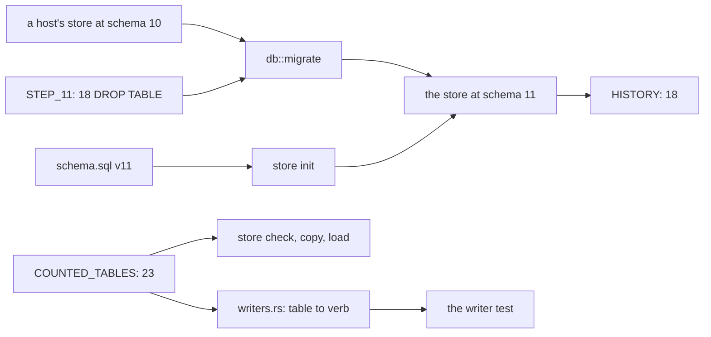
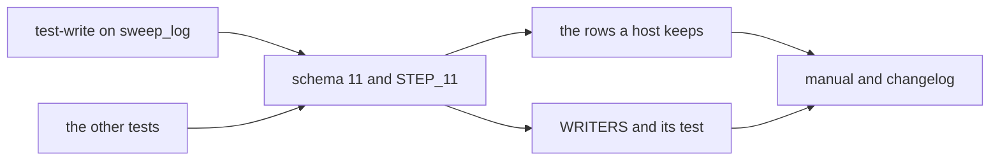

# Plan: the store drops the tables nobody writes (#1770)

**Goal:** schema 11 holds only tables a store verb writes. Eighteen tables leave
`schema.sql`, `COUNTED_TABLES` and `HISTORY`; one step brings a host's store from
10 to 11 with every other row kept; a test makes a counted table with no writer
fail the build.
**Architecture:** one crate (`store`), one version bump. `schema.sql` is what
`store init` writes, `db::STEP_11` is what a host's store runs, `COUNTED_TABLES`
drives `check`, `copy` and `load`, and the new `writers.rs` is the table-to-verb
list the new test reads.
**Tech stack:** Rust 1.89, rusqlite 0.38 bundled, the workspace at
`console/Cargo.toml`, package `store`.
**Spec path:** docs/specs/2026-11-09-store-dead-tables.md
**Detail:** tests
**Target-min:** 22
**Ignore:** console/target, .superlite

Global constraints, exact values:

- `SCHEMA_VERSION: i64 = 11` (`console/store/src/db.rs:21`). `PRAGMA user_version`
  and the `meta` row `schema` follow it, as `step` already does.
- The 18 dropped tables: branch_checks, check_product, cycle_locks, edge_takeover,
  endpoints, energy_samples, health_samples, improve_cap, index_state, limits,
  pause_flag, platform_state, poll_demand, queue_snapshot, refresh_hold,
  refresh_requests, refined, release_history.
- `COUNTED_TABLES: [&str; 23]`: actions, approvals, cycle_history, cycle_notes,
  cycle_progress, cycle_results, cycle_settings, cycles, endings, heartbeats,
  issues, journal, meta, parks, plan_history, planning, planning_answers,
  planning_filed, planning_notes, poll_cost, polls, questions, sweep_log.
- `HISTORY: [&str; 18]` (`console/store/src/load.rs:32`): the 23 counted tables
  without meta, issues, poll_cost, polls and sweep_log.
- `WRITERS: [(&str, &str); 23]` maps each counted table to one verb of
  `console/store/src/main.rs`. It is: meta init, issues cycle-start, cycles
  cycle-start, heartbeats cycle-heartbeat, endings cycle-end, approvals
  approval-record, planning plan-begin, planning_answers plan-answer,
  planning_filed plan-end, planning_notes plan-note, cycle_settings cycle-image,
  cycle_notes cycle-note, cycle_results cycle-end, cycle_progress cycle-end,
  parks park, questions question-asked, cycle_history cycle-end, plan_history
  plan-end, polls poll-begin, poll_cost poll-record, sweep_log sweep-locks,
  actions journal-record, journal journal-attempt.
- Fast tests: `cargo test --locked --manifest-path console/Cargo.toml -p store`.
  Slow: the same with `tests/concurrency.rs` included.
- Done means `scripts/verify.sh --changed` prints no FAIL, and
  `cargo fmt --check` and `cargo clippy --locked --all-targets -p store -- -D
  warnings` are clean.
- Never touched: `scripts/verify.sh`, `scripts/check-generic.sh`, `AGENTS.md`,
  `.pi/`, anything under `instances/`. No `unsafe`, no blanket `allow`.
- No push, no merge, no pull request: the coordinator opens nothing.

Rulings already made:

- `Ruling: drop 18, not the 15 the issue titles - the issue's own writer test
  cannot pass while cycle_locks and poll_demand are counted - cost: two more
  tables leave, and nothing read them (0 non-test hits for each).`
- `Ruling: sequential, T1 before T3 T4 T5 - the store's tests are one crate, so
  a schema change and the tests that name the old tables cannot be green apart -
  cost: a 15 minute critical path instead of a fan-out.`
- `Ruling: main.rs USAGE gains journal-record, journal-attempt, journal-settle and
  journal-open - WRITERS names them and the new test checks that every writer is
  a verb the store answers - cost: one help line grows.`

## Main diagram

## File structure

| file | the one responsibility |
| --- | --- |
| console/store/src/schema.sql | the schema at 11: 23 tables, and comments that match what `pruned` bounds |
| console/store/src/db.rs | `SCHEMA_VERSION`, `STEP_11`, the `migrate` chain, `COUNTED_TABLES` |
| console/store/src/load.rs | `HISTORY`, the tables a store with rows in them is never loaded over |
| console/store/src/cycle.rs, import.rs | the tables a start clears, without cycle_locks |
| console/store/src/exercise.rs | `store test-write`, the writer the concurrency tests spawn |
| console/store/tests/concurrency.rs | the lock and busy tests, on a table that survives |
| console/store/src/schema_tests.rs | init, every step, and the rows a host keeps |
| console/store/src/writers.rs | `WRITERS`, the counted table to the verb that writes it |
| console/store/src/writers_tests.rs | the test that no counted table is left unwritten |
| console/store/src/main.rs | the verb list `USAGE` answers, and the two new modules |
| console/store/src/tests.rs, load_tests.rs, cycle_tests.rs | the store's other tests, on tables that exist |
| host/docs/host.md, api.md, features.md | what the store holds on a host today |
| changelog.d/1770.md | the fragment |

## Predicted schedule

Generated: `bash "$CLI" plan_tools schedule --plan $PLAN`.

## The store's schema and migration

**Probe entry:** `run=store migrate --backup <dir> · call=db::migrate(conn, file, from, now, settings) · run=store check`

### T1 schema 11 and the step that drops the eighteen · Complexity 6 (O-1) · Est. context 29k

**Owns:** console/store/src/schema.sql, console/store/src/db.rs, console/store/src/load.rs, console/store/src/cycle.rs, console/store/src/import.rs
**Components:** 4
**LOC owned:** 150
**Tests:** fast
**Kind:** design
**Model:** sonnet
**Est. time:** 5.5 min
**Consumes:** none
**Produces:** SCHEMA_VERSION: i64 = 11 · STEP_11: &str · COUNTED_TABLES: [&str; 23] · HISTORY: [&str; 18]
e.g. `db::SCHEMA_VERSION` -> 11
e.g. `db::COUNTED_TABLES.len()` -> 23
e.g. `db::migrate(&mut c, &file, 10, 1, &settings)` -> Ok, and `PRAGMA user_version` is 11
**Review Focus:** `test_step_11_drops_only_the_eighteen`: a store at 10 with one row in each of the 18 tables ends at 11 with 23 tables and no trace of the 18; `test_a_failed_step_leaves_the_store_at_10`: STEP_11 given a table it cannot drop leaves `user_version` at 10 with every row; `test_check_counts_23`: `store check --json` answers 23 `rows` keys at 11.
**Steps:** 1 write the failing tests in T3's file names, 2 run: FAIL, 3 implement schema.sql, STEP_11, the migrate arms from 0 through 10, COUNTED_TABLES, HISTORY, and the two clear lists, 4 run: PASS
**Notes:** every arm of `migrate` from 1 to 10 must chain to `step(conn, 11, STEP_11)`; the arm for 10 is new. `DROP TABLE` runs inside one transaction with `foreign_keys` on, and no survivor references a dropped table, so no rebuild like `step_4` is needed. `check` skips missing tables only while `schema < SCHEMA_VERSION`. When you start, no test names a doomed table (T2 and T5 did that). After your change only `schema_tests.rs` is red, and that is T3's file: prove your own work with `cargo test --locked --manifest-path console/Cargo.toml -p store init_` and a store migrated from 10, and touch none of T3's assertions.

## The store's test writer

**Probe entry:** `run=store test-write --batch 1 --rows 3`

### T2 store test-write moves to sweep_log · Complexity 4 (O-2) · Est. context 27k

**Owns:** console/store/src/exercise.rs, console/store/tests/concurrency.rs
**Components:** 2
**LOC owned:** 90
**Tests:** slow
**Kind:** design
**Model:** sonnet
**Est. time:** 3.5 min
**Consumes:** none
**Produces:** none another task consumes
**Review Focus:** `test_write_batches_do_not_collide`: three batches of rows write distinct `what` values and no insert is refused; `test_check_counts_the_written_rows`: `store check` reports the batch's rows under `sweep_log`, not under `branch_checks`.
**Steps:** 1 change the insert and the readers, 2 run: PASS, 3 read the assertions again for the new columns
**Notes:** you run on schema 10, where `branch_checks` still exists, and the suite stays green without it. `sweep_log` is keyed `(issue, at, what)`, so the rows differ by `what` = `test-write-<batch>-<row>`, with `issue` = the batch, `at` = now, `action` = `kept` and `reason` = `concurrency`. It has no foreign key, which is why it is the target and `journal` is not.

## The rows a host keeps

**Probe entry:** `run=store migrate --backup <dir>`

### T3 a store at 10 keeps every row but the eighteen · Complexity 5 (O-1) · Est. context 44k

**Owns:** console/store/src/schema_tests.rs
**Components:** 2
**LOC owned:** 170
**Tests:** fast
**Kind:** design
**Model:** sonnet
**Est. time:** 4.5 min
**Consumes:** SCHEMA_VERSION: i64 (T1) · STEP_11: &str (T1) · COUNTED_TABLES: [&str; 23] (T1)
**Produces:** none another task consumes
**Review Focus:** `test_the_step_from_1_keeps_every_surviving_row`: the fixture's rows of all 23 surviving tables are byte-identical after migrate, and the 18 tables are gone; `test_a_migrated_store_has_the_schema_init_writes`: for every `from` in 1 through 10 the tables, columns, indexes, triggers and CHECKs equal what init writes; `test_a_store_at_11_is_not_migrated_again`: migrate on a store at 11 runs nothing and answers 11.
**Steps:** 1 drop the 18 inserts from `V1_ROWS` and the assertions that named them, 2 run: FAIL, 3 add the drop test for a store at 10 and the version assertions, 4 run: PASS
**Notes:** the refusal wording a verb gives an unmigrated store names the version this binary writes, so `this store writes 10` becomes `this store writes 11`.

## No table without a writer

**Probe entry:** `run=store check`

### T4 every counted table names the verb that writes it · Complexity 5 (O-2) · Est. context 29k

**Owns:** console/store/src/writers.rs, console/store/src/writers_tests.rs, console/store/src/main.rs
**Components:** 2
**LOC owned:** 150
**Tests:** fast
**Kind:** design
**Model:** sonnet
**Est. time:** 4 min
**Consumes:** COUNTED_TABLES: [&str; 23] (T1)
**Produces:** WRITERS: [(&str, &str); 23]
e.g. `WRITERS[0]` -> ("actions", "journal-record")
e.g. `WRITERS.iter().filter(|(t, _)| *t == "cycle_locks").count()` -> 0
e.g. `WRITERS.iter().filter(|(_, v)| *v == "test-write").count()` -> 0
**Review Focus:** `test_every_counted_table_has_a_writer`: the table names of `WRITERS` and of `COUNTED_TABLES` are the same set, sorted, so a counted table with no entry fails; `test_no_writer_is_a_test_verb`: no value is `test-write`; `test_every_writer_is_a_verb`: every value appears in `USAGE`, which is why `USAGE` gains the four journal verbs; `test_writers_are_not_repeated`: no table appears twice.
**Steps:** 1 write the test module and the const, 2 run: FAIL, 3 add `mod writers;` and `#[cfg(test)] mod writers_tests;` to main.rs and the four verbs to `USAGE`, 4 run: PASS
**Notes:** `writers.rs` holds only the const and its doc comment saying where each verb writes; the test lives in `writers_tests.rs`.

## The store's other tests

**Probe entry:** `run=store check`

### T5 the store's other tests let the eighteen go · Complexity 3 (O-3) · Est. context 30k

**Owns:** console/store/src/tests.rs, console/store/src/load_tests.rs, console/store/src/cycle_tests.rs
**Components:** 2
**LOC owned:** 70
**Tests:** fast
**Kind:** design
**Model:** sonnet
**Est. time:** 2.5 min
**Consumes:** none
**Produces:** none another task consumes
**Review Focus:** `test_the_singletons_hold_one_row_each` keeps its cases on a table that still has a CHECK, so the `pause_flag` and `improve_cap` cases leave with their tables; `test_load_refuses_a_store_with_history` names only tables of `HISTORY`.
**Steps:** 1 remove the inserts and cases that name a doomed table, 2 run: PASS on schema 10, 3 keep the same rules on a surviving table where the case still means something
**Notes:** you run on schema 10, where all 18 tables still exist, so this is a green change on its own. `tests.rs:1722` and `:1726` are the `improve_cap` and `pause_flag` CHECK cases; `load_tests.rs:87` inserts `health_samples`; `cycle_tests.rs:274` inserts `cycle_locks`. The 23-key count is T4's test, not yours.

## What a host is told

**Probe entry:** `run=store check`

### T6 the manual and the changelog say schema 11 · Complexity 3 (O-3) · Est. context 28k

**Owns:** host/docs/host.md, host/docs/api.md, host/docs/features.md, changelog.d/1770.md
**Components:** 2
**LOC owned:** 70
**Tests:** fast
**Kind:** design
**Model:** sonnet
**Est. time:** 2.5 min
**Consumes:** none
**Produces:** none
**Review Focus:** `host/docs/host.md` states the schema version the store holds today, which is 11 and not the 4 written there now; `changelog.d/1770.md` has `### Changes` naming the eighteen and `### Adopter action` saying that a downgrade needs the copy in `state/backup/`, because an older release reads schema 11 as `future` and stops with 78.
**Steps:** 1 write the fragment and the three manual lines, 2 run `scripts/check-generic.sh --messages <base>..HEAD`: clean
**Notes:** `host/docs/api.md` says a later schema may add tables; it must say a later schema may also remove them.

## Spec coverage

What is wrong: T1, T5. Findings: T1, T2, T5. Decision: T1, T3, T4. Done when:
T3, T4, T6. Out of scope: no task takes the pause, the limit, the endpoints or
the refresh requests into the store.

## Review Focus

App type: a state store with a migration. Categories: state (a step that fails
partway, two `migrate` runs at once, a store left at 10 with `meta.schema` moved),
protocol (the verb list `USAGE` answers, the JSON of `check`), file (the backup
copy `migrate` makes before it changes a byte), deep (rows preserved across ten
steps).

Specific risks: a `DROP TABLE` a foreign key refuses; `HISTORY` naming a table
that no longer exists, which would make `store load` fail at the wrong moment;
the two clear lists in `cycle.rs` and `import.rs` naming a table that is gone; an
adopter who downgrades onto a schema 11 file.

## Self-review

1. Coverage: the writer test is T4, the rows a host keeps are T1 and T3, the
   changelog is T6, the prune comment is T1.
2. Placeholders: none. Type consistency: `COUNTED_TABLES` is 23 in T1, T4 and T5;
   `HISTORY` is 18 in T1 and T5.
3. Graph: five edges, all execution dependencies, no cycles, no two parallel tasks
   share a file.
4. Measurable fields: every task has Components, LOC owned, Tests, Kind, Model.
5. Review Focus: one app type, four categories, named risks, a probe entry per
   package.
7. Limits: the plan is under 15k characters, no task is over 6 predicted minutes.
